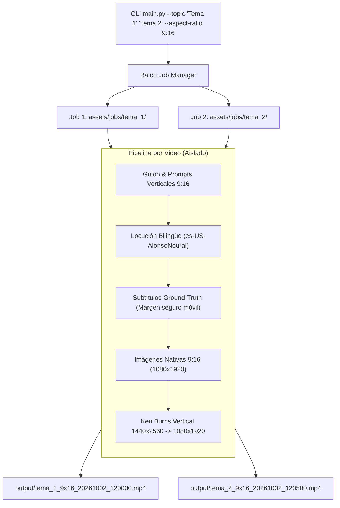

# Plan de Implementación: Videos Verticales (9:16) y Generación Múltiple (Batch)

**Fecha:** Octubre 2026  
**Objetivo:** Permitir la creación de videos verticales en formato 9:16 (Shorts / Reels / TikTok) y habilitar la generación de múltiples videos por lotes sin colisiones en la carpeta de salidas `output/`.

---

## 1. Arquitectura de las Nuevas Características

---

## 2. Detalle de Implementación por Módulo

### A. Soporte para Escala Vertical 9:16 (Shorts / TikTok / Reels)
1. **Configuración y CLI (`src/config.py` y `main.py`):**
   - Nuevo argumento `--aspect-ratio` (opciones: `9:16` y `16:9`, valor por defecto configurable).
   - Resoluciones automáticas:
     - **9:16:** Salida `1080x1920` (Vertical). Búfer intermedio Ken Burns `1440x2560`.
     - **16:9:** Salida `1920x1080` (Horizontal). Búfer intermedio Ken Burns `2560x1440`.
2. **Prompts Visuales (`src/script_generator.py`):**
   - Si `aspect_ratio == "9:16"`, el system prompt instruye generar descripciones visuales con composición vertical centrada (`"vertical 9:16 mobile format, portrait composition, centered focal subject, cinematic 8k, photorealistic"`).
3. **Generador de Imágenes (`src/image_generator.py`):**
   - Solicita dimensiones nativas a las APIs generativas (`width=1080&height=1920` en Pollinations/Flux/Imagen).
   - Procesador de imagen Pillow adapta y encuadra automáticamente cualquier imagen a `1080x1920` con recorte inteligente al centro.
4. **Montaje y Filtros Ken Burns (`src/video_assembler.py`):**
   - El filtro `zoompan` se ajusta a `1440x2560` y escala a `1080x1920`.
   - **Subtítulos con Zona Segura Móvil:** En 9:16, los botones de TikTok/YouTube Shorts (like, comentarios, título de audio) tapan los bordes inferiores y laterales. Se ajustará el estilo de los subtítulos (`MarginV=280` a `320`, `FontSize=24` o `26`) para que queden en el tercio inferior seguro sin estorbar ni ser tapados.

---

### B. Generación Múltiple en `output/` (Batch Processing y Nombres Únicos)
1. **Nombres de Archivo No Colisionantes:**
   - En lugar de sobrescribir `output/video_final.mp4`, cada video se exporta con un nombre representativo:
     `output/{slug_tema}_{aspect_ratio}_{timestamp}.mp4`
     *(ejemplo: `output/segunda_guerra_mundial_9x16_20261002_235012.mp4`)*.
2. **Aislamiento de Espacio de Trabajo por Video (`assets/jobs/<job_id>`):**
   - Cada video procesado tendrá su propio directorio de trabajo aislado para su guion, locución, imágenes descargadas y clips intermedios.
   - Esto evita que un video pise o mezcle assets con otro.
3. **Múltiples Temas por CLI:**
   - Permitir pasar varios temas:
     - Múltiples argumentos: `python main.py --topic "Tema 1" "Tema 2" --aspect-ratio 9:16`
     - O separados por comas: `python main.py --topic "Tema 1, Tema 2"`
     - O archivo de lista: `python main.py --topics-file temas.txt`
   - El orquestador itera sobre cada tema, reporta el avance de cada video y los almacena en `output/`.

---

## 3. Plan de Verificación
1. Ejecutar una prueba con 2 temas en vertical (`--aspect-ratio 9:16`):
   - Tema 1: *"El misterio de los agujeros negros"*
   - Tema 2: *"La biblioteca de Alejandría"*
2. Comprobar que en `output/` existan ambos archivos `.mp4` en resolución `1080x1920`.
3. Capturar fotogramas verticales en `screenshots/` y auditar con `view_file` la composición visual 9:16 y el área segura de los subtítulos.
