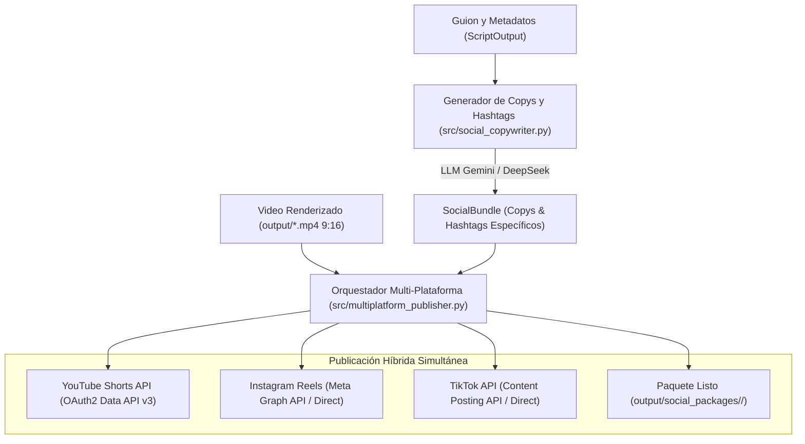

# Plan de Implementación: Publicación Multi-Plataforma (YouTube Shorts, Instagram Reels, TikTok) & Copys/Hashtags con IA

**Fecha:** Octubre 2026  
**Fase:** Fase 7 - Multi-Platform Social Automation  
**Objetivo:** Crear un flujo automatizado que genere copies y hashtags especializados mediante IA para YouTube Shorts, Instagram Reels y TikTok, y ejecute la publicación simultánea mediante un modelo híbrido (conectores de API directos + paquetes listos para publicación inmediata).

---

## 1. Diagrama de Arquitectura del Flujo

---

## 2. Componentes y Responsabilidades

### A. Módulo de Copywriting & Hashtags (`src/social_copywriter.py`)
Genera contenido optimizado según los algoritmos específicos de cada red social:

1. **YouTube Shorts:**
   - **Título:** < 60 caracteres, gancho de alta curiosidad + `#Shorts`.
   - **Descripción:** Resumen cautivador (2-3 oraciones), pregunta para el comentario fijado, llamada a la acción y 4-6 hashtags estratégicos.
   - **Tags:** 10-15 etiquetas SEO para el algoritmo de recomendación de YouTube.

2. **Instagram Reels:**
   - **Hook:** Primera línea llamativa con emoji para detener el scroll antes del botón "...más".
   - **Cuerpo:** Desarrollo educativo breve y conciso con espaciado limpio.
   - **CTA:** Llamada a la acción orientada a interacción ("Guarda este Reel", "Síguenos para más").
   - **Hashtags:** 15 a 20 hashtags estructurados (alta densidad, nicho específico y temáticos de la cuenta).

3. **TikTok:**
   - **Hook & Caption:** Texto directo, ultra-dinámico (< 250 caracteres totales) para no tapar los subtítulos ni la pantalla vertical.
   - **Hashtags:** 5 a 7 hashtags virales y de descubrimiento (`#fyp`, `#parati`, `#aprendecontiktok`, más hashtags específicos del tema).

### B. Módulo de Publicación y Paquetes (`src/multiplatform_publisher.py`)
Implementa el enfoque híbrido solicitado:

1. **Conectores Directos por API:**
   - **YouTube Shorts:** Integración nativa con `src/youtube_uploader.py`.
   - **Instagram Reels:** Conector con Meta Graph API (`POST /{ig_user_id}/media` -> `POST /{ig_user_id}/media_publish`).
   - **TikTok:** Conector con TikTok Content Posting API v2.
   - **Webhook Opcional:** Envío automático a webhooks de automatización (Make, n8n, Metricool, Buffer) si `SOCIAL_WEBHOOK_URL` está configurado.

2. **Generador de Paquete de Publicación Listo (`output/social_packages/<slug>/`):**
   - Para garantizar que el creador de contenido siempre tenga acceso inmediato a todo el material, se generará una carpeta organizada con:
     - `video.mp4`: Copia o enlace al video final en 9:16.
     - `youtube_shorts.txt`: Título exacto, descripción y tags listos para pegar.
     - `instagram_reels.txt`: Caption completo con saltos de línea y 18 hashtags listos para pegar.
     - `tiktok.txt`: Caption ultra-conciso con hashtags virales.
     - `social_manifest.json`: JSON estructurado con todos los metadatos y estado de subida para integraciones externas.

### C. Configuración y CLI (`src/config.py` y `main.py`)
- Nuevas variables de entorno en `.env.example`:
  - `INSTAGRAM_ACCESS_TOKEN`, `INSTAGRAM_BUSINESS_ACCOUNT_ID`
  - `TIKTOK_ACCESS_TOKEN`, `TIKTOK_OPEN_ID`
  - `SOCIAL_WEBHOOK_URL`
- Argumentos CLI:
  - `--publish`: Activa la publicación en redes configuradas.
  - `--publish-platforms`: Especifica plataformas (`youtube`, `instagram`, `tiktok`, `all`).
  - `--no-social-pack`: Omite la creación de la carpeta de paquete local.

---

## 3. Plan de Verificación
1. Validar la generación de copys y hashtags con Gemini / DeepSeek en `src/social_copywriter.py`.
2. Probar la orquestación en `src/multiplatform_publisher.py` verificando:
   - Creación completa de archivos en `output/social_packages/<slug>/`.
   - Inspección del formato y longitud de caracteres de cada red.
   - Flujo de subida con credenciales existentes (YouTube) y manejo resiliente ante credenciales opcionales (Instagram y TikTok).
3. Actualizar `STATE.md` y `ROADMAP.md` y realizar commit de la fase.
